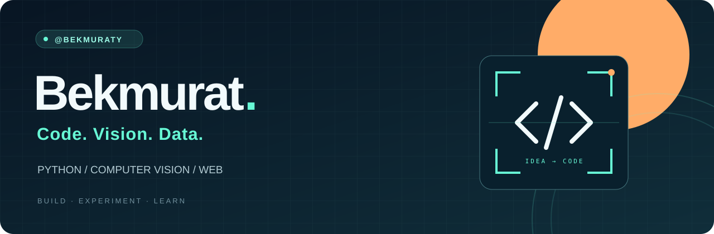
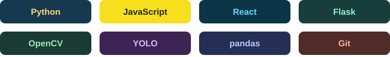

  

<h3 align="center">Hi, I'm Bekmurat 👋</h3>

  Building with Python and React. Exploring computer vision and data through hands-on projects.

  <a href="#-selected-projects">Explore my projects</a> ·
  <a href="https://github.com/BekmuratY?tab=repositories">All repositories</a>

---

### ⚡ What I build

- **Computer vision** — face recognition, object detection and OCR pipelines.
- **Data projects** — collecting, cleaning and exploring real-world datasets.
- **Web applications** — React interfaces connected to Python backends.

### 🧰 Technologies in my projects

  

### 🚀 Selected projects

#### 🔎 [Kazakhstan License Plate OCR](https://github.com/BekmuratY/kz-ocr-validation-pipeline)
A local pipeline for Kazakhstan license plates: YOLOv8 detection, OCR, format validation and evaluation. Includes batch inference and a Streamlit interface.

`Python` `YOLOv8` `PaddleOCR` `Streamlit`

#### 👤 [Biometric System](https://github.com/BekmuratY/Biometric_System)
A full-stack face recognition and user management demo, with a React frontend and a Flask API.

`React` `Flask` `DeepFace` `OpenCV`

#### 🚗 [Kazakhstan Car Market Analysis](https://github.com/BekmuratY/kz_car_market_analysis)
A data workflow for used-car listings: collection, cleaning and exploration of factors related to price.

`Python` `pandas` `BeautifulSoup`

#### 📊 [Bank Marketing Analysis](https://github.com/BekmuratY/bank-marketing-analysis)
An educational project covering data preparation, visual exploration and simple, polynomial and multiple linear regression.

`Python` `Data analysis` `Regression`

---

  <b>Code. Vision. Data.</b> 
  Explore the repositories to see the code, setup guides and experiments.

